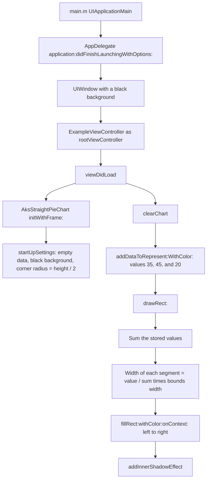

# RectangularPieChartExample

[](https://github.com/aryansbtloe/RectangularPieChartExample)
[](https://github.com/aryansbtloe/RectangularPieChartExample)
[-blue)](LICENSE)

RectangularPieChartExample is an Objective-C iOS sample that draws a horizontal, capsule-shaped bar of colored segments. `AksStraightPieChart`, a `UIView`, splits its width in proportion to the integer values you add, clips the bar to a corner radius of half its height, and paints a Core Graphics inner shadow. The repository is one Xcode application target for iPhone and iPad, with a deployment target of iOS 6.1, Automatic Reference Counting, and no package manager. The chart file headers still name an earlier project, Betify. The previous README contained only the project title.

## Features

The sample does the following, and nothing beyond it. There is no storyboard, xib, settings bundle, or network code.

- `AksStraightPieChart` is a `UIView` subclass. `initWithFrame:` and `awakeFromNib` both call `startUpSettings`.
- `startUpSettings` stores an empty data array, sets the background to black, sets `masksToBounds` to true, and sets the layer corner radius to half the view's height.
- `addDataToRepresent:WithColor:` appends one segment. The value is an `int` and the color is a `UIColor`. Each entry is an `NSDictionary` with the keys `value` and `color`.
- A value less than or equal to zero, a nil color, or a color that is not a `UIColor` is ignored. The method then logs `Hey...you are passing invalid data to the aks straight pie chart...please correct it.`
- `clearChart` removes every entry and calls `setNeedsDisplay`.
- `drawRect:` sums the stored values, gives each segment a width of `value / sum` times the view width, and lays the segments from left to right. When a segment's `origin.x` is already greater than zero, the method adds another `0.20` points to `origin.x` before filling.
- After the segments are filled, `addInnerShadowEffect` clips to a rounded rectangle and draws an inner shadow. That method is adapted from a Stack Overflow answer; see [License](#license).
- The example controller clears the chart and adds three segments: `35` green, `45` gray, and `20` red.
- The application window background is black. The only screen is `ExampleViewController`, built in code.
- Supported interface orientations in the Info.plist are portrait, landscape left, and landscape right. The iPad list also includes portrait upside down.
- The target requires the `armv7` device capability and links UIKit, Foundation, and CoreGraphics.

## How the sample runs



## Requirements

The project file is the source of these requirements. The repository does not pin a newer Xcode or iOS SDK.

- Xcode that can open this project. `LastUpgradeCheck` is `0460` (Xcode 4.6) and `compatibilityVersion` is Xcode 3.2.
- The iOS SDK. `SDKROOT` is `iphoneos` and `IPHONEOS_DEPLOYMENT_TARGET` is `6.1`.
- Objective-C with Automatic Reference Counting (`CLANG_ENABLE_OBJC_ARC = YES`). The C language standard in the project is `gnu99`.
- Device family `1,2` (iPhone and iPad).
- Frameworks linked by the target: UIKit, Foundation, and CoreGraphics. `AksStraightPieChart.m` also imports `QuartzCore/QuartzCore.h`.
- For an on-device build, the project sets `CODE_SIGN_IDENTITY` to `iPhone Developer` for the `iphoneos` SDK.
- `UIRequiredDeviceCapabilities` contains `armv7`.

The prefix header warns if the iOS SDK macros indicate a version earlier than 3.0. The deployment target itself is 6.1.

## Installation

The repository is an Xcode project. It contains no Podfile, Cartfile, Package.swift, Makefile, or other installer.

Clone the repository and open the project:

```sh
git clone https://github.com/aryansbtloe/RectangularPieChartExample.git
cd RectangularPieChartExample
open RectangularPieChartExample.xcodeproj
```

Run the `RectangularPieChartExample` target. The checked-in scheme lives at `RectangularPieChartExample.xcodeproj/xcuserdata/alok.xcuserdatad/xcschemes/RectangularPieChartExample.xcscheme`. There is no shared scheme under `xcshareddata`.

The chart class is compiled straight into that application target. The project has no separate library or framework target. To use the view in another UIKit target, add the same two files the example compiles:

- `RectangularPieChartExample/AksStraightPieChart/AksStraightPieChart.h`
- `RectangularPieChartExample/AksStraightPieChart/AksStraightPieChart.m`

Those two files keep the copyright notice in their headers, and `addInnerShadowEffect` keeps the Creative Commons terms described under [License](#license).

## Usage

The public interface is the whole of `AksStraightPieChart.h`:

```objc
@interface AksStraightPieChart : UIView
{
    NSMutableArray *dataToRepresent;
}

- (void)addDataToRepresent:(int)value WithColor:(UIColor *)color;
- (void)clearChart;

@end
```

`ExampleViewController` builds the chart in `viewDidLoad`. The frame is the screen bounds inset by one sixth of the width and by half the height minus 20 points. The controller then clears the chart and adds the three sample segments:

```objc
	CGRect screenRect = [[UIScreen mainScreen]bounds];

	AksStraightPieChart * straightPieChart = [[AksStraightPieChart alloc]initWithFrame:CGRectInset(screenRect,screenRect.size.width/6,screenRect.size.height/2-20)];
	[[self view]addSubview:straightPieChart];

	[straightPieChart clearChart];
    [straightPieChart addDataToRepresent:35 WithColor:[UIColor colorWithRed:0.178 green:0.709 blue:0.106 alpha:1.000]];
    [straightPieChart addDataToRepresent:45 WithColor:[UIColor colorWithWhite:0.379 alpha:1.000]];
    [straightPieChart addDataToRepresent:20 WithColor:[UIColor colorWithRed:0.971 green:0.000 blue:0.088 alpha:1.000]];
```

`AppDelegate` creates the window, sets that controller as the root, and shows the window:

```objc
    self.window = [[UIWindow alloc] initWithFrame:[[UIScreen mainScreen] bounds]];
    // Override point for customization after application launch.
    self.window.backgroundColor = [UIColor blackColor];
	[self.window setRootViewController:[[ExampleViewController alloc]init]];
    [self.window makeKeyAndVisible];
```

`addDataToRepresent:WithColor:` accepts the entry only when the value is greater than zero and the color is a `UIColor`:

```objc
- (void)addDataToRepresent:(int)value WithColor:(UIColor *)color {
    if (value > 0 && color && [color isKindOfClass:[UIColor class]]) {
        [dataToRepresent addObject:[NSDictionary dictionaryWithObjectsAndKeys:[NSNumber numberWithInt:value], @"value", color, @"color", nil]];
    } else NSLog(@"\nHey...you are passing invalid data to the aks straight pie chart...please correct it.");
}
```

`clearChart` drops the stored entries and redraws:

```objc
- (void)clearChart {
    [dataToRepresent removeAllObjects];
    [self setNeedsDisplay];
}
```

Segment widths come from `drawRect:`. The sum is a `float`. Each segment's width is its value divided by that sum, multiplied by the dirty rect's width. Segments after the first are shifted right by an extra `0.20` points, and that shift is included in the rectangle remembered for the next segment:

```objc
        float percentage          = currentSegmentValue / sumOfAllSegmentValues;

        progressRect = rect;
        progressRect.size.width  *= percentage;
        progressRect.origin.x    += lastSegmentRect.origin.x + lastSegmentRect.size.width;

        if (progressRect.origin.x > 0) progressRect.origin.x += 0.20;

        lastSegmentRect = progressRect;

        [self fillRect:lastSegmentRect withColor:color onContext:currentGraphicsContext];
```

With the sample values `35`, `45`, and `20`, the shares are `0.35`, `0.45`, and `0.20`. An empty data array skips both loops, so `drawRect:` still calls `addInnerShadowEffect` and does not divide by the sum.

## Project structure

```
.
├── LICENSE
├── README.md
├── RectangularPieChartExample.xcodeproj
│   ├── project.pbxproj
│   ├── project.xcworkspace
│   └── xcuserdata/alok.xcuserdatad    # checked-in scheme, breakpoints, and UI state
└── RectangularPieChartExample
    ├── AksStraightPieChart
    │   ├── AksStraightPieChart.h
    │   └── AksStraightPieChart.m
    ├── AppDelegate.h
    ├── AppDelegate.m
    ├── ExampleViewController.h
    ├── ExampleViewController.m
    ├── main.m
    ├── RectangularPieChartExample-Info.plist
    ├── RectangularPieChartExample-Prefix.pch
    ├── en.lproj/InfoPlist.strings
    ├── Default.png
    ├── Default@2x.png
    └── Default-568h@2x.png
```

| Path | Role |
| --- | --- |
| `AksStraightPieChart.h` / `.m` | Chart view. The file header comment names the project Betify. |
| `ExampleViewController.m` | Creates the chart and adds the three sample values. |
| `AppDelegate.m` | Creates the window and installs the example controller. The lifecycle methods below `didFinishLaunchingWithOptions:` are empty. |
| `main.m` | Calls `UIApplicationMain` with `AppDelegate`. |
| `RectangularPieChartExample-Info.plist` | Bundle id prefix `com.kiplmobile24`, version `1.0`, orientations, and `armv7`. |
| `RectangularPieChartExample-Prefix.pch` | Prefix header. Imports UIKit and Foundation for Objective-C files. |
| `en.lproj/InfoPlist.strings` | Empty localization stub. |
| `Default.png`, `Default@2x.png`, `Default-568h@2x.png` | Launch images included by the target. |
| `project.pbxproj` | Single application target `RectangularPieChartExample`. Organization name Konstant Info Private Limited. |

## Customisation

The chart has no properties, no Interface Builder inspectables, and no plist keys of its own. Callers change it through the frame and the two public methods.

- The rectangle passed to `initWithFrame:` is the view bounds. `startUpSettings` reads the height of that rectangle once and sets the corner radius to half of it. `awakeFromNib` does the same with the bounds at awake time. The class does not update the radius again in `layoutSubviews` or `drawRect:`.
- `addDataToRepresent:WithColor:` is the data input. Widths follow the integers relative to their sum. Colors are the `UIColor` objects you pass.
- `clearChart` is the reset. The example calls it before the three `addDataToRepresent:WithColor:` lines.

These values are written in the implementation:

| Choice | Method | Value in source |
| --- | --- | --- |
| Background | `startUpSettings` | `[UIColor blackColor]` |
| Corner radius | `startUpSettings` | `CGRectGetHeight(bounds) / 2` |
| Clipping | `startUpSettings` | `masksToBounds = YES` |
| Extra shift after the first segment | `drawRect:` | `0.20` points |
| Shadow color | `addInnerShadowEffect` | white `0.000`, alpha `0.700` |
| Shadow offset | `addInnerShadowEffect` | `(0, 1)` |
| Shadow blur | `addInnerShadowEffect` | `3` |
| Outer path inset | `addInnerShadowEffect` | `-42` points |

Application settings that are present in the project:

| Setting | Where | Value |
| --- | --- | --- |
| Window background | `AppDelegate.m` | black |
| Bundle identifier | Info.plist | `com.kiplmobile24.${PRODUCT_NAME:rfc1034identifier}` |
| Version | Info.plist | short version `1.0`, bundle version `1.0` |
| Deployment target | `project.pbxproj` | iOS `6.1` |
| Device family | `project.pbxproj` | iPhone and iPad |
| ARC | `project.pbxproj` | enabled |
| Debug preprocessor macros | `project.pbxproj` | `DEBUG=1` |
| Release extra flags | `project.pbxproj` | `-DNS_BLOCK_ASSERTIONS=1` |
| Code signing | `project.pbxproj` | `iPhone Developer` for `iphoneos` |

There is no configuration file, environment variable, or build script in the repository.

## Contributing

Issues and pull requests are welcome on GitHub: [aryansbtloe/RectangularPieChartExample](https://github.com/aryansbtloe/RectangularPieChartExample).

The repository has no unit tests, test target, or continuous-integration workflow. Please describe how you built and ran the Xcode target when you change behavior.

Leave the existing file-header copyright notices in place. Leave `addInnerShadowEffect` under the Creative Commons terms in [License](#license), and keep that attribution if you adapt the method.

## License

This repository mixes three kinds of terms. Read [LICENSE](LICENSE) for the MIT text and its scope.

**Documentation by Alok Singh.** `README.md` and `LICENSE` are copyright 2026 Alok Singh and are released under the MIT License. The MIT grant covers material in this repository of which Alok Singh is the copyright holder. It is limited to that documentation.

**2013 source notices.** These files begin with `Copyright (c) 2013 Konstant Info Private Limited. All rights reserved.` and were left unchanged:

- `RectangularPieChartExample/AksStraightPieChart/AksStraightPieChart.h`
- `RectangularPieChartExample/AksStraightPieChart/AksStraightPieChart.m`
- `RectangularPieChartExample/ExampleViewController.h`
- `RectangularPieChartExample/ExampleViewController.m`
- `RectangularPieChartExample/AppDelegate.h`
- `RectangularPieChartExample/AppDelegate.m`
- `RectangularPieChartExample/main.m`

The MIT license does not relicense those files.

**Inner shadow, CC BY-SA 3.0.** `-addInnerShadowEffect` in `AksStraightPieChart.m` is adapted from [Daniel Thorpe's answer](https://stackoverflow.com/a/5542116) to ["Inner shadow effect on UIView layer?"](https://stackoverflow.com/questions/4431292/inner-shadow-effect-on-uiview-layer). The path construction, the `-42` inset, the even-odd fill, and the comments in this method match revision 7 of that answer, edited by [Regexident](https://stackoverflow.com/users/227536/regexident) on 19 February 2012. The answer describes the approach as following a suggestion by Costique on the same question. Stack Overflow distributes that revision under [Creative Commons Attribution-ShareAlike 3.0](https://creativecommons.org/licenses/by-sa/3.0/) ([licensing help](https://stackoverflow.com/help/licensing)). The revision list is at <https://stackoverflow.com/posts/5542116/revisions>.

Changes in this repository relative to that revision:

- The drawing is wrapped in the instance method `addInnerShadowEffect`.
- The answer's initial fill of the visible path with red is omitted. This class fills the colored segments first.
- The shadow color is `[UIColor colorWithWhite:0.000 alpha:0.700]`. The answer used black at alpha `0.5`.
- The rounded path, clip, shadow offset `(0, 1)`, blur `3`, even-odd fill, outer inset of `-42`, and the comments (including their original spelling) are retained.

ShareAlike applies to that method and to adaptations of it. Those adaptations stay under CC BY-SA 3.0. The MIT grant does not cover the method.

`AppDelegate`'s empty lifecycle methods and their comments, `main.m`, and the prefix header match the application template shipped with the Xcode that last upgraded this project (`LastUpgradeCheck` `0460`). This repository does not include a separate license for that template text.

## Author

Alok Singh

- GitHub: <https://github.com/aryansbtloe>
- Website: <https://bestlatestapps.com>
